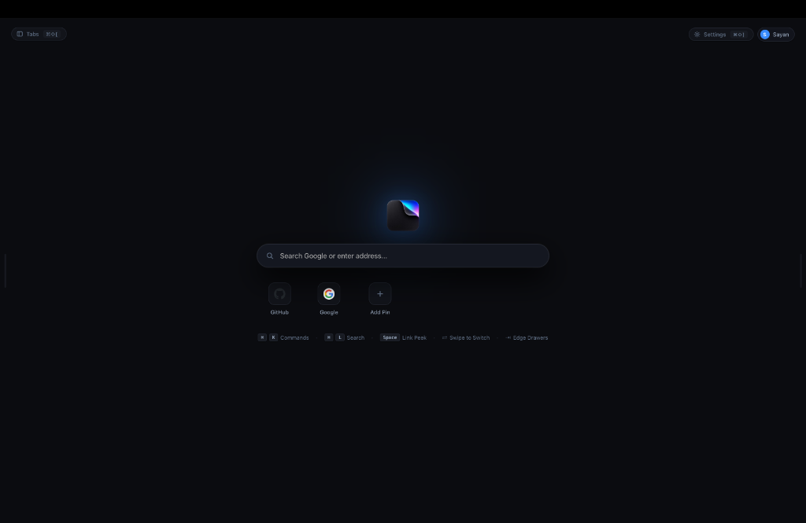
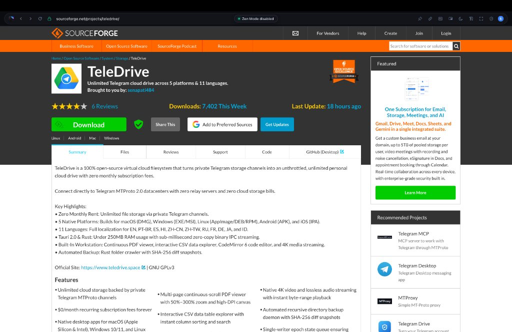
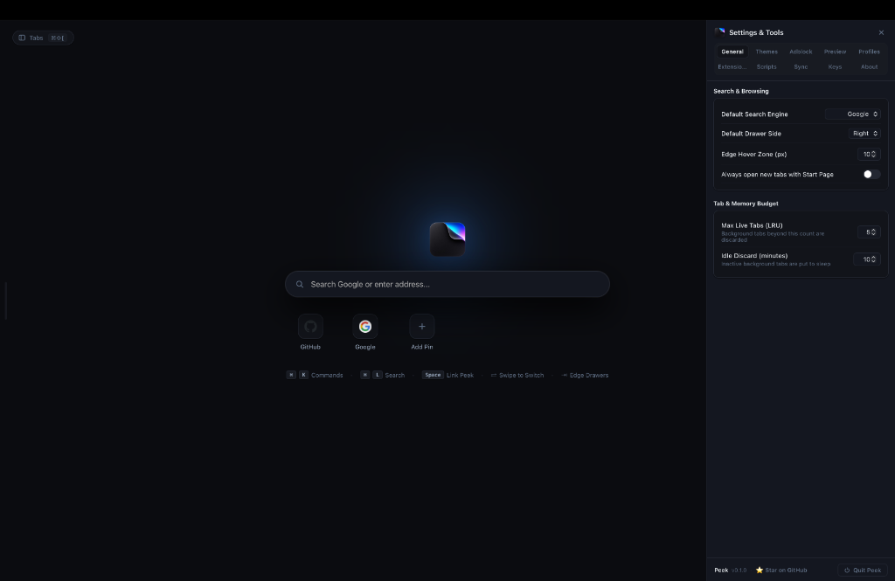
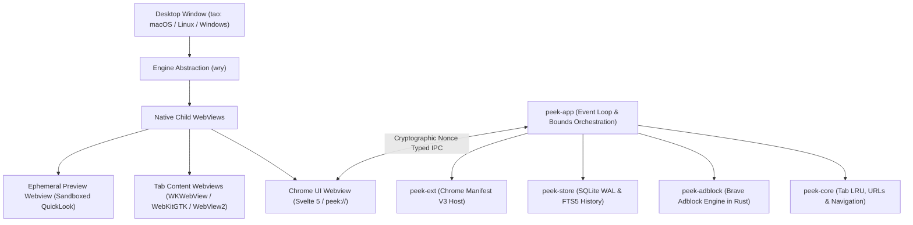

<p align="center">
  
</p>

<h1 align="center">Peek</h1>

<p align="center">
  <strong>An ultra-fast, minimalist, distraction-free browser built with Rust and Svelte.</strong><br>
  Zero-bloat native webview engine, ephemeral hover QuickLook, edge-activated vertical tabs, automatic memory hibernation, and built-in adblocking for macOS, Linux, and Windows.
</p>

<p align="center">
  <a href="https://github.com/senapati484/peek/releases/tag/v0.1.0"></a>
  <a href="https://sourceforge.net/projects/peek-browser/"></a>
  <a href="https://sourceforge.net/projects/peek-browser/files/latest/download"></a>
  <a href="https://github.com/senapati484/peek/actions/workflows/ci.yml"></a>
  <a href="https://github.com/senapati484/peek/releases"></a>
  <a href="LICENSE"></a>
  <a href="https://www.rust-lang.org"></a>
  
  
</p>

<p align="center">
  <a href="#-downloads--installers">Downloads</a> •
  <a href="#-overview">Overview</a> •
  <a href="#-visual-showcase">Screenshots</a> •
  <a href="#-key-features">Features</a> •
  <a href="#-architecture">Architecture</a> •
  <a href="#-keyboard-shortcuts--gestures">Shortcuts</a> •
  <a href="#-building-from-source">Building</a> •
  <a href="#-documentation">Documentation</a>
</p>

---

## 📦 Downloads & Installers

Official release binaries and standalone installer packages are compiled, cryptographically verified, and mirrored across **GitHub Releases** and **[SourceForge (peek-browser)](https://sourceforge.net/projects/peek-browser/)**:

| Platform | Package Format | Architecture | GitHub Release | SourceForge Mirror | Quick Installation |
| :--- | :--- | :--- | :--- | :--- | :--- |
| **macOS** | Apple Disk Image (`.dmg`) | Universal (Apple Silicon & Intel) | [**peek.dmg**](https://github.com/senapati484/peek/releases/download/v0.1.0/Peek-macos-universal.dmg) | [**peek.dmg**](https://sourceforge.net/projects/peek-browser/files/v0.1.0/peek.dmg/download) | Open DMG & drag `Peek.app` to `/Applications` |
| **macOS** | Apple Disk Image (`.dmg`) | Apple Silicon (M1/M2/M3/M4) | [**peek-arm64.dmg**](https://github.com/senapati484/peek/releases/download/v0.1.0/Peek-macos-arm64.dmg) | [**peek-arm64.dmg**](https://sourceforge.net/projects/peek-browser/files/v0.1.0/peek-arm64.dmg/download) | Optimized Apple Silicon installer |
| **macOS** | Portable Bundle (`.zip`) | Universal (Apple Silicon & Intel) | [**peek-macos.zip**](https://github.com/senapati484/peek/releases/download/v0.1.0/Peek-macos-universal.zip) | [**peek-macos.zip**](https://sourceforge.net/projects/peek-browser/files/v0.1.0/peek-macos.zip/download) | Extract and run `Peek.app` |
| **Linux** | Native Debian Package (`.deb`) | `x86_64` / `amd64` | [**peek.deb**](https://github.com/senapati484/peek/releases/download/v0.1.0/peek_0.1.0_amd64.deb) | [**peek.deb**](https://sourceforge.net/projects/peek-browser/files/v0.1.0/peek.deb/download) | `sudo dpkg -i peek.deb` |
| **Linux** | Standalone Tarball (`.tar.gz`) | `x86_64` | [**peek-linux.tar.gz**](https://github.com/senapati484/peek/releases/download/v0.1.0/Peek-linux-x86_64.tar.gz) | [**peek-linux.tar.gz**](https://sourceforge.net/projects/peek-browser/files/v0.1.0/peek-linux.tar.gz/download) | `tar -xzf peek-linux.tar.gz && ./install.sh` |
| **Windows** | Standalone Executable (`.exe`) | `x86_64` | — | [**peek.exe**](https://sourceforge.net/projects/peek-browser/files/v0.1.0/peek.exe/download) | Direct portable executable |
| **Windows** | Portable Archive (`.zip`) | `x86_64` | [**peek-windows.zip**](https://github.com/senapati484/peek/releases/download/v0.1.0/Peek-windows-x86_64.zip) | [**peek-windows.zip**](https://sourceforge.net/projects/peek-browser/files/v0.1.0/peek-windows.zip/download) | Extract and run `Peek.exe` |
| **Checksums** | SHA256 Verification | All Platforms | [**SHA256SUMS.txt**](https://github.com/senapati484/peek/releases/download/v0.1.0/SHA256SUMS.txt) | [**SHA256SUMS.txt**](https://sourceforge.net/projects/peek-browser/files/v0.1.0/) | `sha256sum -c SHA256SUMS.txt` |

> [!TIP]
> You can also browse and download all assets directly from the [SourceForge Files Directory](https://sourceforge.net/projects/peek-browser/files/v0.1.0/).

---

## ⚡ Overview

Modern web browsers have evolved into monolithic operating systems. They consume gigabytes of RAM, clutter screens with permanent tabs and toolbars, and constantly track user behavior.

**Peek** is engineered for speed, focus, and minimalism:

- **Ephemeral Chrome:** When browsing, Peek completely disappears. There are no static tab strips, status bars, or utility ribbons crowding your viewport. When you need to navigate, a lean 36px omnibar or proximity-activated edge drawer glides into view in sub-millisecond response time.
- **Zero Electron Bloat:** Peek runs directly on the operating system's native webview engine (`WKWebView` on macOS, `WebKitGTK` on Linux, and `WebView2` on Windows) bound to native Rust via `tao` and `wry`. Baseline memory idles around **40–70 MB RAM** instead of 1.5–2.5 GB.
- **Space-to-Peek (Finder QuickLook):** Hover any web link or pinned site card and press <kbd>Space</kbd> (or hold <kbd>Shift</kbd>) to instantly pop open a live, sandboxed preview card without leaving your current context or cluttering your tab list.
- **Smart Memory Discarding:** Background tabs that sit idle are automatically put to sleep by Peek's LRU tab manager while preserving their full title, scroll position, and session state. The UI dashboard reports real-time memory saved (e.g. `570MB saved`). Clicking or navigating to a sleeping tab wakes it instantaneously.
- **Native Adblock & Anti-Tracking:** Built-in network-level blocking and cosmetic DOM filtering powered by Brave's native Rust adblock engine with EasyList and uBlock Origin compatibility.

---

## 🖼️ Visual Showcase

### Distraction-Free Start Screen & Speed-Dial
Focused search with ambient backlight, speed-dial pinned site cards, and immediate keyboard accessibility shortcuts (`⌘K`, `⌘L`, `Space`, `⇄`).

<p align="center">
  
</p>

### Browse Mode & Ultra-Slim Docked Top Bar
When navigating, chrome collapses into an ultra-slim header with navigation chevrons, SSL indicators, quick page utilities (Pin, Clean URL, Markdown, PiP, Smart Night Mode, Reader Mode, Adblock Shield), profile avatars, and inline toast status pills.

<p align="center">
  
</p>

### Vertical Tabs Workspace & Memory Saver Dashboard
Hover the left screen edge or press `⌘⇧[` to reveal vertical tabs with pinned tabs, tab groups, instant filtering, and real-time memory savings statistics (`380MB saved`) with 1-click **Hibernate Others**.

<p align="center">
  
</p>

### Settings, Content Blocking & Extension Engine
Hover the right edge or press `⌘⇧]` to customize privacy filters, manage Manifest V3 extensions, separate browsing profiles, and configure LRU memory discard thresholds.

<p align="center">
  
</p>

---

## ✨ Key Features

### 🎯 Minimalist Dual-Mode Chrome
- **Start Mode:** When opening a blank tab (`⌘T`), Peek displays a focused, centered search bar with pinned website speed-dial cards, smooth hover lift, and keyboard navigation affordances.
- **Browse Mode:** While visiting a website, chrome collapses into an ultra-slim 36px top bar with SSL certificate badges, navigation chevrons, reload status, privacy shield, and active profile avatars.

### 🔍 Space-to-Peek (Live Link QuickLook)
- Inspired by macOS Finder QuickLook: hover over any link or pinned website card and press <kbd>Space</kbd> (or hold <kbd>Shift</kbd> / <kbd>⌘</kbd>).
- A sandboxed, floating preview webview instantly renders the destination page without creating a new tab. Release <kbd>Space</kbd> or press <kbd>Esc</kbd> to dismiss.

### ⚡ 0ms Tab Cycling HUD
- Swiping horizontally with two fingers on the top omnibar or pressing `⌘1`–`⌘9` / `⌘Tab` immediately cycles tabs with zero latency.
- An ephemeral high-contrast HUD pill (`[Tab 2 of 6] GitHub — Repository`) provides immediate confirmation of tab switches before the page paints.

### 💤 Proactive LRU Tab Hibernation
- Peek monitors memory pressure and tab idle duration.
- Tabs exceeding the configured threshold (e.g. 5 live tabs or 10 minutes idle) are safely discarded from RAM while caching their URL, title, favicon, and exact vertical scroll offset.
- The Tabs drawer shows live statistics (e.g. `1 live • 6 sleeping (570MB saved)`), with a one-click button to **Hibernate Others**.

### 🛡️ Native Rust Content Blocking
- Integrates Brave's high-performance Rust adblock engine directly into the native request loop.
- Network requests matching ad, tracker, and telemetry blocklists are stopped before execution.
- Injects cosmetic CSS element hiding stylesheets into the DOM for clean, distraction-free reading.

### 🧩 Chrome Extension & Manifest V3 Host Engine
- **Direct Chrome Web Store Support:** Navigate to any extension page on the [Chrome Web Store](https://chromewebstore.google.com). Peek seamlessly reveals an active **Add to Peek** action button right on the store page and in the top omnibar for 1-click installation.
- **Multiple Installation Methods:** Install extensions by pasting a Chrome Web Store URL, a 32-character extension ID, or loading unpacked local directories and `.crx` / `.zip` packages via **Settings > Extensions**.
- **Scoped Manifest V3 Runtime:** Injects content scripts and styles into matching pages with an asynchronous, Promise-ready `chrome.*` and `browser.*` polyfill supporting `storage.local`, `storage.sync`, `declarativeNetRequest`, `tabs`, `action`, and `runtime` messaging without compromising memory safety.

### 👤 Multi-Profile Data Partitioning
- Create dedicated browsing profiles (e.g. *Personal*, *Work*, *Research*).
- Completely isolates cookies, localStorage, session history, and cache directories between profiles.

---

## 🏛️ Architecture

Peek separates pure browser state, native webview orchestration, UI presentation, and storage into modular, decoupled Rust crates:



### Crate Breakdown

| Crate | Responsibility |
| :--- | :--- |
| [**`peek-app`**](crates/peek-app) | Desktop executable entry point, Tao event loop, pre-warmed drawer webview, bounds geometry, and dock/menu integration. |
| [**`peek-engine`**](crates/peek-engine) | Trait abstractions over `wry` webview creation, navigation hooks, subframe filtering, and custom `peek://` asset protocol handlers. |
| [**`peek-core`**](crates/peek-core) | Pure domain logic: tab collection, activation history, LRU tab discarding, session restoration, and search query resolver. |
| [**`peek-adblock`**](crates/peek-adblock) | Brave adblock engine wrapper, network request filters, and cosmetic element hiding. |
| [**`peek-preview`**](crates/peek-preview) | Hover coordinate geometry, dwell timing, and window clamping algorithms. |
| [**`peek-ext`**](crates/peek-ext) | Manifest V3 parser, CRX package unpacking, and content script registration. |
| [**`peek-store`**](crates/peek-store) | SQLite persistence (WAL mode) for tabs, sessions, bookmarks, cookies, and FTS5 full-text search. |
| [**`peek-ipc`**](crates/peek-ipc) | Typed JSON message protocol secured with cryptographic session nonces. |
| [**`ui/`**](ui) | User interface written in Svelte 5 (Runes) and compiled via Vite into static assets embedded in the binary. |

---

## ⌨️ Keyboard Shortcuts & Gestures

| Shortcut | Gesture / Key | Action |
| :--- | :--- | :--- |
| `⌘ T` / `Ctrl T` | Press | Open a new blank tab (reveals centered omnibar & pinned sites) |
| `⌘ W` / `Ctrl W` | Press | Close current active tab (or selected tab in drawer) |
| `⌘ L` / `Ctrl L` | Press | Focus the address and search omnibar |
| `⌘ K` / `Ctrl K` | Press | Open unified Command Palette (`>` mode) & omnibar |
| `⌘ .` / `⌘ ⇧ F` | Press | **Zen Mode:** 100% Ghost Canvas with auto-hiding floating bar |
| `⌘ ⇧ D` | Press | **Smart Dark Mode:** Instant contrast inversion for blinding white sites |
| `⌘ ⇧ P` | Press | **Picture-in-Picture:** Pop active video into a native floating window |
| `⌘ ⌥ C` | Press | **Copy Markdown Link:** Copy `[Page Title](Clean URL)` for Notion/Slack/GitHub |
| `⌘ +` / `⌘ -` / `⌘ 0` | Press | Hardware accelerated page zoom (Zoom in, Zoom out, Reset 100%) |
| `⌘ ⇧ N` | Press | Open built-in Research Scratchpad markdown notes |
| `⌘ R` / `Ctrl R` | Press | Reload current page |
| `⌘ 1` – `⌘ 9` | Press | Switch directly to tab 1 through 9 |
| `⌘ ⇧ [` / `Ctrl ⇧ [` | Press / Hover Left Edge | Toggle vertical tabs & spaces drawer |
| `⌘ ⇧ ]` / `Ctrl ⇧ ]` | Press / Hover Right Edge | Toggle settings & tools drawer |
| `⌥ ←` / `Alt ←` | Press | Navigate back in browsing history |
| `⌥ →` / `Alt →` | Press | Navigate forward in browsing history |
| `Space` | Press while hovering | **Space-to-Peek:** Live QuickLook preview of link or pinned site |
| `Shift + Hover` | Hover with modifier | Live link preview card |
| `⇄ Swipe Bar` | 2-finger horizontal swipe | Cycle rapidly between open tabs with HUD feedback |
| `Esc` | Press | Dismiss preview / close drawer / clear tab filter |

---

## 🛠️ Building from Source

### Prerequisites

- **Rust:** Stable Rust 1.80+ installed via [rustup](https://rustup.rs):
  ```bash
  rustup default stable
  ```
- **Node.js:** Node.js 18+ and npm for compiling the Svelte frontend:
  ```bash
  node --version
  ```
- **System Dependencies:**
  - **macOS:** macOS 12.0+ with Xcode Command Line Tools (`xcode-select --install`).
  - **Linux:** GTK 3, WebKitGTK, and libayatana-appindicator:
    ```bash
    sudo apt-get install -y libgtk-3-dev libwebkit2gtk-4.1-dev libayatana-appindicator3-dev librsvg2-dev dpkg-dev
    ```
  - **Windows:** Microsoft Edge WebView2 runtime (pre-installed on Windows 10 & 11) and MSVC C++ Build Tools.

### Development Workflow

1. **Clone the repository:**
   ```bash
   git clone https://github.com/senapati484/peek.git
   cd peek
   ```

2. **Build frontend assets:**
   ```bash
   cd ui
   npm install
   npm run build
   cd ..
   ```

3. **Run the test suite (70 tests):**
   ```bash
   cargo test --workspace
   ```

4. **Launch Peek in development mode:**
   ```bash
   cargo run -p peek-app
   ```

### Building Standalone Release Installers

Peek includes automated build and packaging scripts for each platform:

- **macOS (Generates `Peek.app` & Universal DMG):**
  ```bash
  ./scripts/build_app.sh
  open Peek.app
  ```

- **Linux (Generates `Peek-linux-x86_64.tar.gz` & `.deb` package):**
  ```bash
  ./scripts/build_linux.sh
  ```

- **Windows (Generates `Peek-windows-x86_64.zip`):**
  ```powershell
  .\scripts\build_windows.ps1
  ```

---

## 📚 Documentation

Detailed architectural deep-dives and engineering documentation are maintained in the [`docs/`](docs/) directory:

- 🏛️ **[System Architecture](docs/architecture.md)** — Multi-child webview layout, subframe isolation, typed IPC engine, LRU memory lifecycle, and native adblocking.
- 🗄️ **[Database & Storage Engine](docs/database.md)** — SQLite WAL mode, FTS5 prefix search index, sync triggers, table schemas, and profile isolation.
- ✨ **[Features & Gestures Guide](docs/features.md)** — Space-to-Peek QuickLook, trackpad omnibar swipe tab switching, edge proximity drawers, and memory saver hibernation.

---

## 🤝 Contributing

Contributions from the open-source community are warmly welcomed!

1. Fork the repository and create your feature branch: `git checkout -b feature/amazing-feature`.
2. Ensure all tests pass: `cargo test --workspace`.
3. Check UI bundle integrity: `cd ui && npx svelte-check && npm run build`.
4. Commit your changes and open a descriptive Pull Request.

Please review [CONTRIBUTING.md](CONTRIBUTING.md) for code style, architectural constraints, and PR guidelines.

---

## 📄 License

This project is licensed under the open-source [MIT License](LICENSE).
