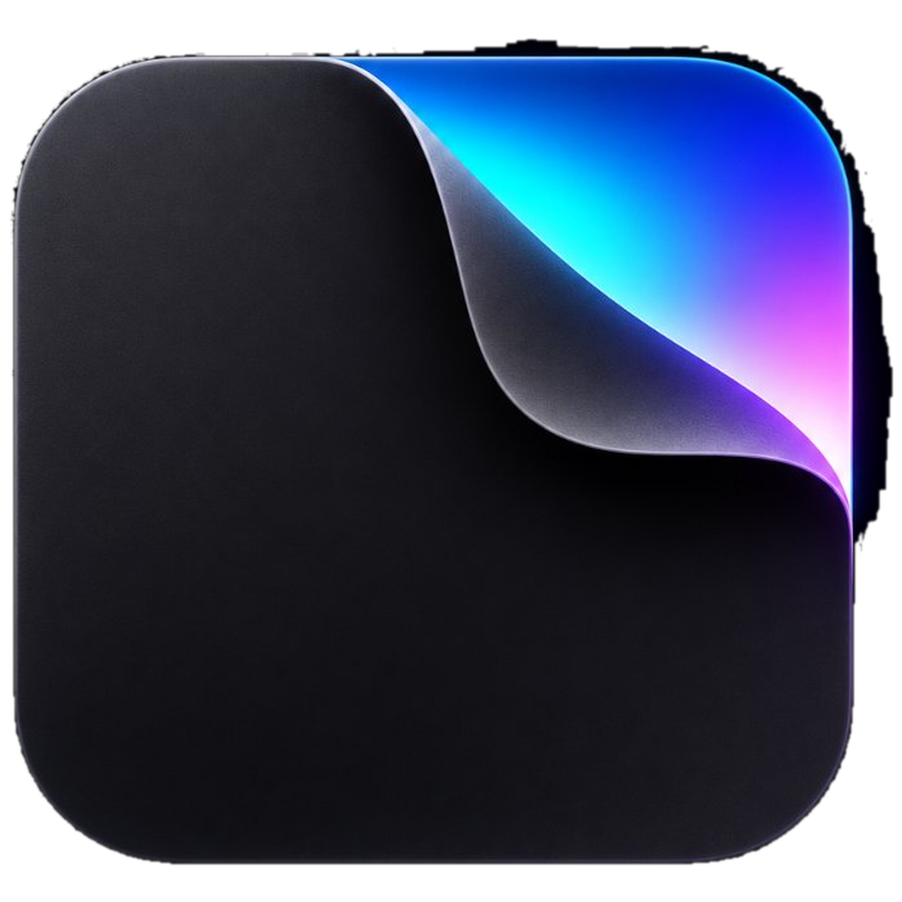
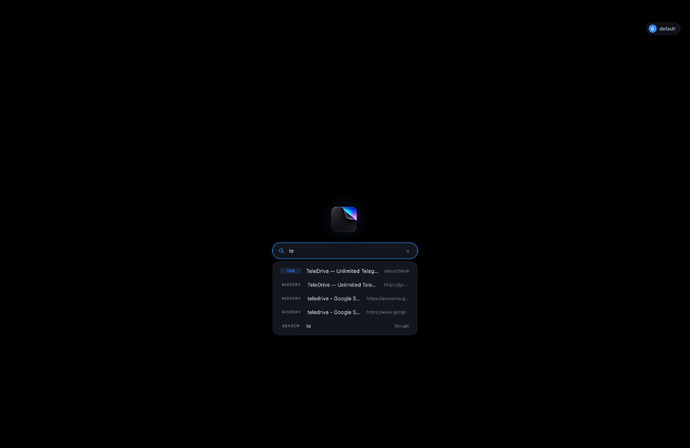
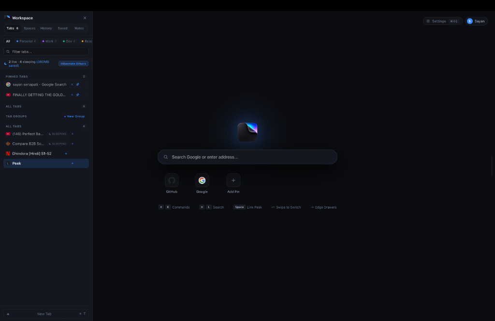
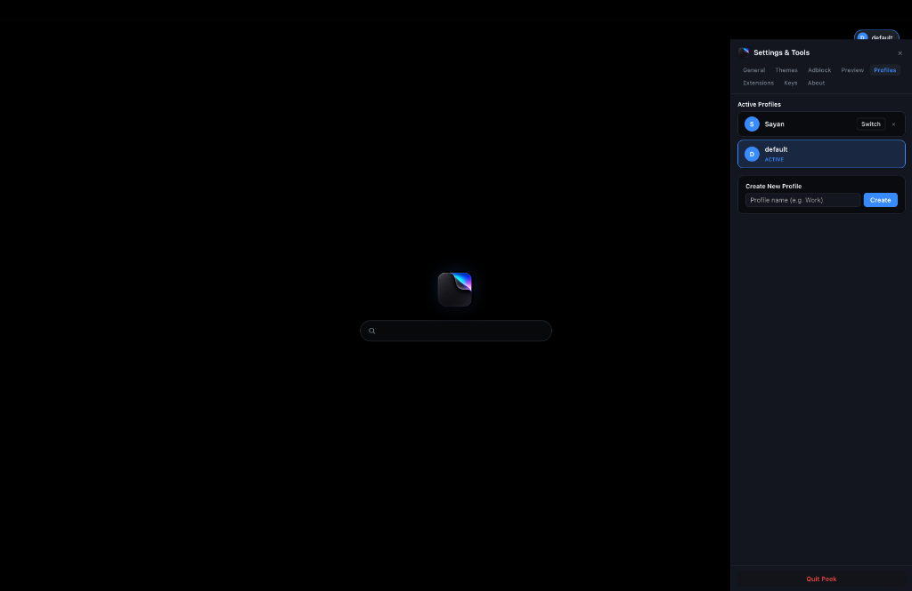
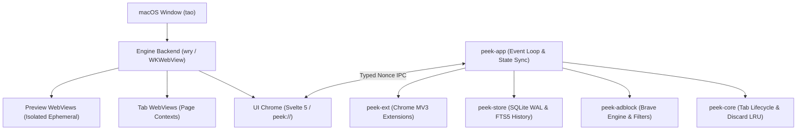

<p align="center">
  
</p>

<h1 align="center">Peek</h1>

<p align="center">
  <strong>An ultra-lightweight, minimalist macOS browser built with Rust and Svelte.</strong><br>
  Hover previews, edge-revealed vertical tabs, zero-bloat WKWebView engine, and native content blocking.
</p>

<p align="center">
  <a href="#overview">Overview</a> •
  <a href="#visual-showcase">Screenshots</a> •
  <a href="#key-features">Features</a> •
  <a href="#architecture">Architecture</a> •
  <a href="#keyboard-shortcuts">Shortcuts</a> •
  <a href="#getting-started">Getting Started</a> •
  <a href="#contributing">Contributing</a>
</p>

---

## Overview

Modern web browsers have become heavy, distracting desktop operating systems of their own. They consume gigabytes of memory, crowd the screen with toolbars, and encourage tab hoard overload.

**Peek** takes the opposite approach:
- **Ephemeral Chrome:** When browsing, Peek steps out of the way. There are no permanent tab strips or status bars. When you need to navigate, a 36px top omnibar or edge-activated drawer slides into view.
- **Native OS Engine:** Peek runs on macOS's native `WKWebView` via Rust (`tao` and `wry`). It carries zero Electron overhead, idling around 40–70 MB of baseline RAM.
- **Link Hover Previews:** Hold `Shift` (or your configured modifier) and hover any link to peek at the target page in a floating preview card. Press Enter or click to promote it to a full tab.
- **Smart Memory Discarding:** Background tabs that sit idle are automatically discarded from memory while retaining their scroll position and title. When reactivated, they reload seamlessly.
- **Built-in Content Filtering:** Integrated ad and tracker blocking powered by Brave's native Rust adblock engine with network blocking and cosmetic DOM filters.

---

## Visual Showcase

### Minimalist Start Screen
Clean, distraction-free start screen featuring a centered search box, quick corner navigation chips, and edge touchpoints.

<p align="center">
  
</p>

### Fast Omnibar Suggestions
Instant fuzzy matching across open tabs, visit history (powered by SQLite FTS5), and search engines.

<p align="center">
  
</p>

### Edge-Revealed Vertical Tabs Drawer
Hover the left screen edge or press `⌘⇧[` to reveal vertical tabs with audio indicators, sleep markers, and drag-and-drop reordering.

<p align="center">
  
</p>

### Settings, Adblock & Multi-Profile Management
Hover the right edge or press `⌘⇧]` to customize privacy filters, manage separate browsing profiles, and inspect extensions.

<p align="center">
  
</p>

---

## Key Features

- **Dual-Mode Dynamic Interface:**
  - *Start Mode:* On empty tabs, a centered search input with immediate focus and corner navigation affordances.
  - *Browse Mode:* A compact 36px top omnibar providing SSL security badges, URL navigation, and quick access to tools.
- **Modifier-Triggered Live Previews:**
  - Ephemeral picture-in-picture preview cards appear when hovering links while pressing `Shift` or `⌘`.
  - Preview webviews run sandboxed, muted, and disappear cleanly when you move your cursor away.
- **Edge Proximity Drawers:**
  - Move the cursor to the left edge to view open tabs.
  - Move to the right edge to access Settings, Profiles, Adblock, and Extensions.
  - Fully navigable via keyboard shortcuts (`⌘⇧[` and `⌘⇧]`).
- **Native Adblock & Cosmetic DOM Filtering:**
  - EasyList and uBlock Origin compatible rule matching.
  - Sub-millisecond rule evaluation in pure Rust with cosmetic stylesheet injection.
  - Per-site toggles with real-time blocked counter badges.
- **Multi-Profile Data Partitioning:**
  - Switch between work, personal, and research profiles.
  - Complete isolation of cookies, localStorage, session state, and extension storage.
- **Fast SQLite Session Store:**
  - WAL-mode SQLite storage with full-text search (FTS5) for instant history queries.
  - Preserves open tabs, active tab focus, and window geometry across restarts.
- **Lightweight WebExtensions MV3 Sandbox:**
  - Chrome Manifest V3 extension parser with support for declarative content scripts and custom stylesheets.

---

## Architecture

Peek separates pure browser state, native webview orchestration, UI presentation, and storage into modular Rust crates:



### Crate Organization

| Crate | Responsibility |
| :--- | :--- |
| **`peek-app`** | Desktop executable, Tao event loop, macOS Dock/menu integration, window bounds geometry. |
| **`peek-engine`** | Trait abstractions over `wry` webview creation, navigation events, and custom asset protocol handlers. |
| **`peek-core`** | Pure domain logic: tab collection, activation history, LRU tab discarding, and search query resolver. |
| **`peek-adblock`** | Brave adblock engine wrapper, network request filters, and cosmetic element hiding. |
| **`peek-preview`** | Hover coordinate geometry, dwell timing, and window clamping algorithms. |
| **`peek-ext`** | Manifest V3 parser, CRX package unpacking, and content script registration. |
| **`peek-store`** | SQLite persistence for tabs, sessions, bookmarks, cookies, and FTS5 search. |
| **`peek-ipc`** | Typed JSON message protocol secured with cryptographic session nonces. |
| **`ui/`** | Front-end interface written in Svelte 5 (Runes) and compiled via Vite into static `peek://` assets. |

---

## Keyboard Shortcuts

| Shortcut | Action |
| :--- | :--- |
| `⌘ T` | Open a new blank tab (reveals centered omnibar) |
| `⌘ W` | Close the current active tab |
| `⌘ L` | Focus the address bar / omnibar |
| `⌘ R` | Reload current page |
| `⌘ 1` – `⌘ 9` | Switch directly to tab 1 through 9 |
| `⌘ ⇧ [` | Toggle vertical tabs drawer (left side) |
| `⌘ ⇧ ]` | Toggle settings & tools drawer (right side) |
| `⌥ ←` | Navigate back in history |
| `⌥ →` | Navigate forward in history |
| `Shift + Hover` | Live link hover preview card |
| `Esc` | Close open drawer / dismiss suggestions / cancel preview |

---

## Getting Started

### Prerequisites

- **Rust:** Stable Rust 1.80+ installed via [rustup](https://rustup.rs):
  ```bash
  rustup default stable
  ```
- **Node.js:** Node.js 18+ and npm for compiling the UI assets:
  ```bash
  node --version
  ```
- **Platform Dependencies:**
  - **macOS:** macOS 12.0 or newer with Xcode Command Line Tools (`xcode-select --install`).
  - **Linux:** GTK 3 and WebKitGTK development libraries:
    ```bash
    sudo apt-get install -y libgtk-3-dev libwebkit2gtk-4.1-dev libayatana-appindicator3-dev librsvg2-dev
    ```
  - **Windows:** Microsoft Edge WebView2 runtime (pre-installed on Windows 10 & 11) and MSVC C++ Build Tools.

### Development Setup

1. **Clone the repository:**
   ```bash
   git clone https://github.com/senapati484/peek.git
   cd peek
   ```

2. **Install UI dependencies and build the Svelte bundle:**
   ```bash
   cd ui
   npm install
   npm run build
   cd ..
   ```

3. **Run the test suite:**
   ```bash
   cargo test --workspace
   ```

4. **Launch Peek in development mode:**
   ```bash
   cargo run -p peek-app
   ```

### Building Release Packages

Peek includes automated packaging scripts for each platform:

- **macOS (`Peek.app` & Universal DMG):**
  ```bash
  ./scripts/build_app.sh
  open Peek.app
  ```

- **Linux (`Peek-linux-x86_64.tar.gz` & `.deb`):**
  ```bash
  ./scripts/build_linux.sh
  ```

- **Windows (`Peek-windows-x86_64.zip`):**
  ```powershell
  .\scripts\build_windows.ps1
  ```

---

## Documentation

In-depth technical guides and architectural specifications are available in the [`docs/`](docs/) directory:

- 🏛️ **[System Architecture](docs/architecture.md)** — Multi-child webview layout, subframe isolation, typed IPC engine, LRU memory lifecycle, and native adblocking.
- 🗄️ **[Database & Storage Engine](docs/database.md)** — SQLite WAL mode, FTS5 prefix search index, sync triggers, table schemas, and profile isolation.
- ✨ **[Features & Gestures Guide](docs/features.md)** — Space-to-Peek QuickLook, trackpad omnibar swipe tab switching, edge proximity drawers, and memory saver hibernation.

---

## Contributing

Contributions from the open-source community are welcome! Whether you are fixing bugs, improving the Svelte UI, optimizing Rust webview handlers, or enhancing documentation:

1. Fork the repository and create your branch: `git checkout -b feature/my-feature`.
2. Ensure all tests pass: `cargo test --workspace`.
3. Verify the frontend: `cd ui && npm run build && npx svelte-check`.
4. Submit a clear, descriptive Pull Request.

Please see [CONTRIBUTING.md](CONTRIBUTING.md) for full guidelines on architecture standards, code style, and testing requirements.

---

## License

This project is licensed under the open-source MIT License. See [LICENSE](LICENSE) for details.
