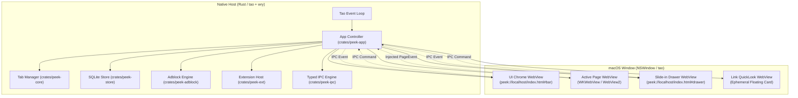
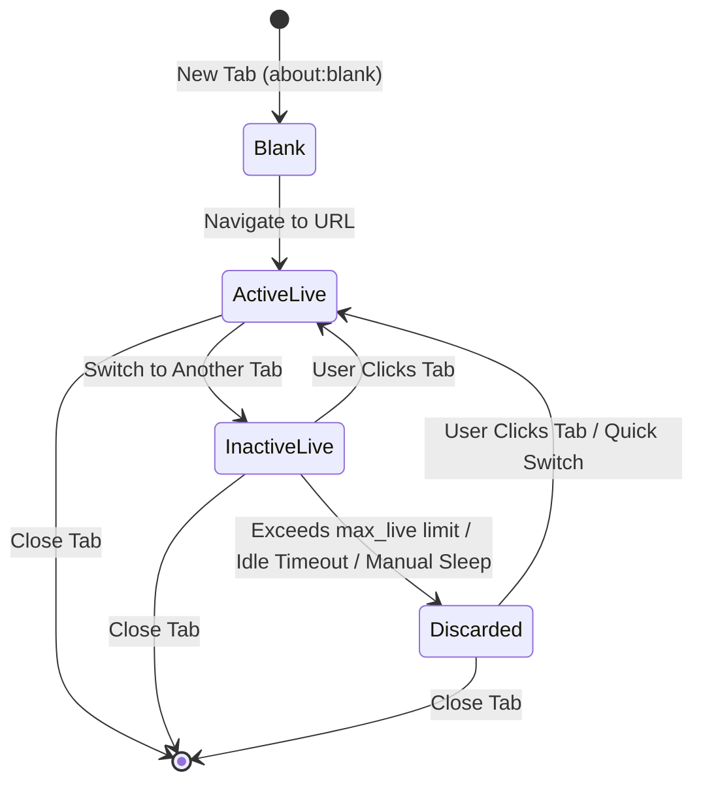

# Peek — System Architecture

Peek is a minimalist, ultra-responsive web browser built from the ground up in pure Rust. It rejects the multi-hundred-megabyte overhead of Electron and Chromium-shell browsers, utilizing native system WebViews (`tao` + `wry` on top of WebKit on macOS and WebView2 on Windows) managed through a strict multi-child webview hierarchy.

---

## 1. High-Level System Architecture

Peek coordinates multiple independent webviews inside a single native window. Rather than rendering browser UI and web pages in the same DOM context, Peek separates the browser chrome, the active page, sliding drawers, and preview popups into isolated, hardware-accelerated child webviews.



---

## 2. Window & Child WebView Layout

Peek lays out child webviews inside the parent window using direct pixel bounds and native OS view hierarchies (`NSView` on macOS, child `HWND` on Windows):

```
+--------------------------------------------------------------------------+
| Top Bar Child WebView (Height: 36px, peek://localhost/index.html#bar)    |
+--------------------------------------------------------------------------+
|                                                                          |
|                                                                          |
|                     Active Tab Child WebView                             |
|                     (Fills remainder of window)                          |
|                                                                          |
|        +-----------------------------------+                             |
|        | Ephemeral Link QuickLook WebView  |                             |
|        | (480x320, rounded corners, zoom)  |                             |
|        +-----------------------------------+                             |
|                                                  +-----------------------+
|                                                  | Slide-In Drawer       |
|                                                  | (Tabs or Settings)    |
+--------------------------------------------------+-----------------------+
```

### Child Webview Roles

| View | Origin / URL | Bounds | Role & Behavior |
| :--- | :--- | :--- | :--- |
| **Top Bar (Chrome)** | `peek://localhost/index.html#bar` | `(0, 0, w, 36px)` or `(0, 0, w, h)` when omnibar open on start | Minimalist address bar, back/forward buttons, security lock, and autocomplete suggestions. |
| **Active Tab** | External web URL | `(0, 36, w, h - 36)` | Standard live browsing. WKWebView on macOS with full autofill, media controls, and content scripts. |
| **Drawer** | `peek://localhost/index.html#drawer` | Left: `(0, 0, 290, h)`<br/>Right: `(w - 360, 0, 360, h)` | Slide-in sidebar for Vertical Tabs, Memory Saver, Profiles, Themes, Adblock, and Extensions. |
| **QuickLook Preview** | Target hyperlink URL | Clamped bounding box (e.g. 480x320) | Ephemeral floating card with rounded corners (`CALayer` mask) and high-res scaled page preview. |

---

## 3. Subframe & Widget URL Isolation

A crucial architectural principle in Peek is **subframe URL isolation**:

- Complex web applications (such as Google Accounts, OAuth flows, and embedded widgets) frequently load iframes like `ogs.google.com/u/0/widget/account` or `accounts.google.com/gsi/`.
- In naive WebView wrappers, frame navigation callbacks can trigger on every subframe, stomping on the top-level tab URL and replacing the address bar.
- Peek filters subframe and widget navigations in `crates/peek-app/src/app.rs`. It strictly queries the canonical top-level document URL (`engine.url(view)`) and validates against subframe patterns before updating tab state, history, or the omnibar.

---

## 4. LRU Tab Lifecycle & Memory Saver

Peek enforces a strict memory budget. Browsers commonly balloon to gigabytes of RAM when dozens of tabs are left open. Peek solves this with an active **Least-Recently-Used (LRU) Discard Pipeline**:



### Memory Lifecycle Details
1. **Live Limit Enforcement:** Peek maintains up to `max_live` (default: 5) simultaneous active WebViews. When a 6th tab is opened, the least recently used inactive tab is discarded.
2. **Discard Process:** The tab's `wry::WebView` is completely destroyed from memory. The tab metadata (URL, page title, favicon, and last scroll position `scroll_y`) remains stored in memory and SQLite.
3. **Protection Rules:** Audible tabs (playing media), tabs with unsaved form input, and the currently active tab are strictly protected from automatic discard.
4. **Scroll Offset Restoration:** When a discarded tab is reactivated, a new `wry::WebView` is spawned and navigates to the stored URL. Upon `LoadEvent::Finished`, Peek restores the exact scroll position via a dual-timeout `window.scrollTo(0, pos)`.
5. **Memory Saver Dashboard:** Users can see active vs. sleeping tabs and estimated RAM saved directly in the Tabs drawer, with a one-click **"Hibernate Others"** button to free resources immediately.

---

## 5. IPC Architecture

Peek implements a secure, asynchronous IPC bridge between the native Rust host and the Svelte frontend:

- **Protocol Scheme:** UI assets are served through a custom local protocol (`peek://localhost/`) with zero-copy binary streaming and strict cache controls.
- **Nonce Authentication:** During initialization, a cryptographically secure 128-bit random nonce is injected into the UI webview. All incoming IPC payloads must present this nonce to prevent cross-origin injection.
- **Bi-directional Typed Messaging:**
  - **Host -> UI (`Event`):** Tabs state (`tabsChanged`), loading status (`loading`), title changes, suggestions, cookies count, and adblock counts.
  - **UI -> Host (`Command`):** Navigation (`navigate`), tab operations (`newTab`, `closeTab`, `switchTab`, `discardTab`, `discardOtherTabs`, `cycleTab`), profile switches, and settings.
  - **Page -> Host (`PageEvent`):** Hover detection, link QuickLook triggers, trackpad edge wheel gestures, scroll offsets, and audio playback states.

---

## 6. Built-in Brave Adblock Engine

Peek integrates Brave's native Rust adblock engine (`crates/peek-adblock`):

- **Network-Level Blocking:** Intercepts web requests and matches against compiled filter lists (EasyList, EasyPrivacy, and uBlock filters).
- **Cosmetic Filtering:** Parses and compiles CSS selectors into WebKit-compatible user stylesheets to hide empty ad placeholders and intrusive banner elements.
- **Per-Host Rules:** Allows instant per-site shield toggling stored in SQLite (`site_rules` table).
- **Performance:** Matching runs entirely in compiled native Rust data structures with sub-millisecond lookups.

---

## 7. Extension Host (Manifest V3)

Peek includes a modular Manifest V3 extension engine (`crates/peek-ext`):

- **Package Support:** Directly extracts unpacked folders, `.crx3` packages, and standard ZIP archives.
- **Content Scripts:** Parses `content_scripts` declarations, matches URL patterns (`<all_urls>`, wildcard hosts, exact path prefixes), and injects scripts at `document_start` or `document_end`.
- **API Shims:** Provides a safe `chrome.*` / `browser.*` JS compatibility shim (`chrome.runtime`, `chrome.storage.local`, `chrome.tabs`).
