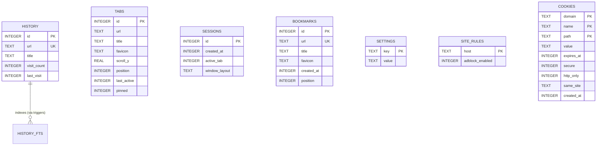

# Peek — Database & Storage Engine

Peek utilizes a zero-latency embedded SQLite database engine (`crates/peek-store`) operating in Write-Ahead Logging (`WAL`) mode with strict foreign key constraints. 

Every user profile maintains an isolated SQLite database file, guaranteeing complete partition between browsing sessions, history, cookies, and settings.

---

## 1. File Locations & Directory Structure

Profile databases are stored in standard OS application support directories:

| OS | Default Database Path |
| :--- | :--- |
| **macOS** | `~/Library/Application Support/dev.Peek.Peek/profiles/<profile>/peek.db` |
| **Windows** | `%APPDATA%\Peek\Peek\profiles\<profile>\peek.db` |
| **Linux** | `~/.local/share/Peek/profiles/<profile>/peek.db` |

Each profile directory contains:
```
profiles/<profile_name>/
├── peek.db            # Main SQLite database file
├── peek.db-wal        # Write-Ahead Log file (concurrent reads + writes)
├── peek.db-shm        # Shared memory index for WAL
└── web_data/          # Persistent WebKit/WebView2 cookie and local storage cache
```

---

## 2. Pragmas & Performance Configuration

On every database initialization and connection open, the following pragmas are executed:

```sql
PRAGMA journal_mode = WAL;
PRAGMA synchronous = NORMAL;
PRAGMA foreign_keys = ON;
PRAGMA busy_timeout = 5000;
PRAGMA cache_size = -2000;  -- 2 MB memory cache
```

- **WAL Mode:** Enables concurrent reader threads without blocking the writer thread.
- **Synchronous = NORMAL:** Safe against corruption on power loss in WAL mode while eliminating disk write stalls.
- **Busy Timeout = 5000ms:** Automatically retries transient locks rather than failing instantly.

---

## 3. Database Schema (Version 3)



---

## 4. Tables & Indexes Specification

### 4.1 `history`
Stores visited URLs, page titles, visit counts, and timestamps for autocomplete and history searches.

```sql
CREATE TABLE history (
    id INTEGER PRIMARY KEY AUTOINCREMENT,
    url TEXT NOT NULL UNIQUE,
    title TEXT NOT NULL DEFAULT '',
    visit_count INTEGER NOT NULL DEFAULT 1,
    last_visit INTEGER NOT NULL
);

CREATE INDEX idx_history_last_visit ON history(last_visit DESC);
CREATE INDEX idx_history_visit_count ON history(visit_count DESC);
```

### 4.2 `history_fts` (Full-Text Search Index)
An FTS5 external content virtual table that provides sub-millisecond prefix searching across titles and URLs for the omnibar.

```sql
CREATE VIRTUAL TABLE history_fts USING fts5(
    title,
    url,
    content='history',
    content_rowid='id'
);

-- Automated triggers synchronize the FTS index whenever history changes:
CREATE TRIGGER history_ai AFTER INSERT ON history BEGIN
    INSERT INTO history_fts(rowid, title, url) VALUES (new.id, new.title, new.url);
END;

CREATE TRIGGER history_ad AFTER DELETE ON history BEGIN
    INSERT INTO history_fts(history_fts, rowid, title, url) VALUES('delete', old.id, old.title, old.url);
END;

CREATE TRIGGER history_au AFTER UPDATE ON history BEGIN
    INSERT INTO history_fts(history_fts, rowid, title, url) VALUES('delete', old.id, old.title, old.url);
    INSERT INTO history_fts(rowid, title, url) VALUES (new.id, new.title, new.url);
END;
```

#### FTS5 Query Sanitization
To prevent user keystrokes from causing syntax errors (e.g. typing quotes, colons, or wildcards), queries are sanitized by tokenizing alphanumeric words and wrapping each in quoted prefix expressions:
```sql
-- Search input: "rust webview"
-- Executed FTS query: "rust"* "webview"*
SELECT rowid FROM history_fts WHERE history_fts MATCH '"rust"* "webview"*' LIMIT 10;
```

---

### 4.3 `tabs`
Stores tab sessions across restarts and maintains hibernation metadata for discarded tabs.

```sql
CREATE TABLE tabs (
    id INTEGER PRIMARY KEY,
    url TEXT NOT NULL,
    title TEXT NOT NULL DEFAULT '',
    favicon TEXT,
    scroll_y REAL NOT NULL DEFAULT 0.0,
    position INTEGER NOT NULL,
    last_active INTEGER NOT NULL,
    pinned INTEGER NOT NULL DEFAULT 0
);

CREATE INDEX idx_tabs_position ON tabs(position ASC);
```

- `scroll_y`: The vertical scroll offset captured before the tab was discarded or closed, restored on wake.
- `position`: Visual tab order preserved across restarts.
- `pinned`: Whether the tab is pinned (protected from LRU eviction and memory hibernation).

---

### 4.4 `sessions`
Maintains overall window geometry and the currently active tab ID.

```sql
CREATE TABLE sessions (
    id INTEGER PRIMARY KEY CHECK (id = 1),
    created_at INTEGER NOT NULL,
    active_tab INTEGER,
    window_layout TEXT NOT NULL DEFAULT ''
);
```

---

### 4.5 `bookmarks`
Saved and pinned URLs with position ordering and favicon URLs.

```sql
CREATE TABLE bookmarks (
    id INTEGER PRIMARY KEY AUTOINCREMENT,
    url TEXT NOT NULL UNIQUE,
    title TEXT NOT NULL DEFAULT '',
    favicon TEXT,
    created_at INTEGER NOT NULL,
    position INTEGER NOT NULL DEFAULT 0
);

CREATE INDEX idx_bookmarks_position ON bookmarks(position ASC);
```

---

### 4.6 `settings`
Key-value store holding user preferences encoded as typed JSON strings.

```sql
CREATE TABLE settings (
    key TEXT PRIMARY KEY,
    value TEXT NOT NULL
);
```

Supported keys:
- `max_live`: Maximum active live WebViews (default: `5`).
- `idle_discard_minutes`: Inactive tab sleep timeout (default: `10`).
- `hover_delay_ms`: Link hover delay before previewing (default: `150`).
- `preview_width` / `preview_height`: QuickLook card dimensions.
- `preview_modifier_only`: Require ⌘ or Shift key for preview.
- `search_engine`: Default search provider (Google, DuckDuckGo, Brave, etc.).
- `theme`: UI appearance (`system`, `dark`, `light`).
- `accent`: Accent color (`blue`, `purple`, `emerald`, `amber`, `rose`).

---

### 4.7 `site_rules`
Domain-specific permissions and content shield configurations.

```sql
CREATE TABLE site_rules (
    host TEXT PRIMARY KEY,
    adblock_enabled INTEGER NOT NULL DEFAULT 1
);
```

---

### 4.8 `cookies`
Persistent cookie storage per profile, allowing cross-session authentication.

```sql
CREATE TABLE cookies (
    domain      TEXT NOT NULL,
    name        TEXT NOT NULL,
    path        TEXT NOT NULL DEFAULT '/',
    value       TEXT NOT NULL,
    expires_at  INTEGER,
    secure      INTEGER NOT NULL DEFAULT 0,
    http_only   INTEGER NOT NULL DEFAULT 0,
    same_site   TEXT,
    created_at  INTEGER NOT NULL,
    PRIMARY KEY (domain, name, path)
);

CREATE INDEX cookies_domain_idx ON cookies(domain);
```

---

## 5. Schema Versioning & Migrations

Database versioning is tracked via SQLite's internal `user_version` PRAGMA:

- `PRAGMA user_version = 0`: New database; executes initial schema setup (`MIGRATION_V1`).
- `PRAGMA user_version = 1`: Adds `cookies` table and indexes (`MIGRATION_V2`).
- `PRAGMA user_version = 2`: Adds `favicon` to `bookmarks` and `pinned` to `tabs` (`MIGRATION_V3`).
- `PRAGMA user_version = 3`: Current active schema version.

All schema migrations run inside an atomic transaction:
```sql
BEGIN IMMEDIATE;
-- Migration statements
PRAGMA user_version = 3;
COMMIT;
```
